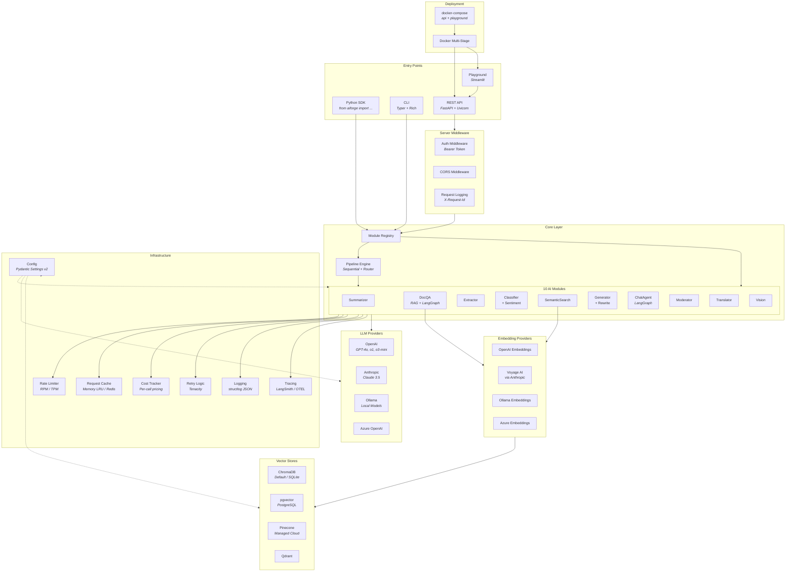
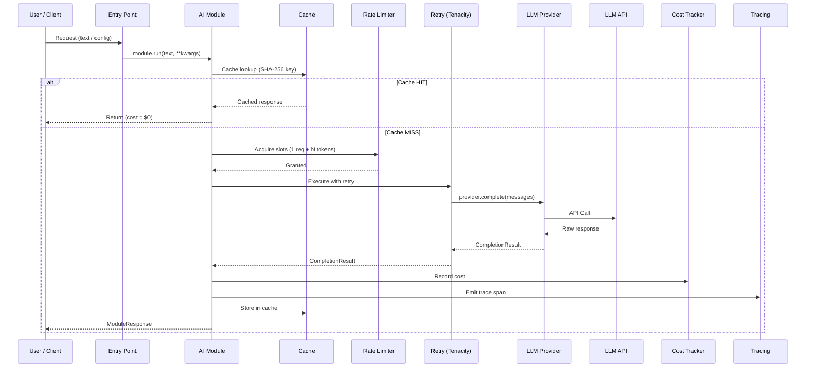
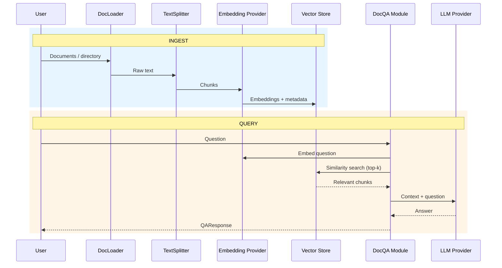
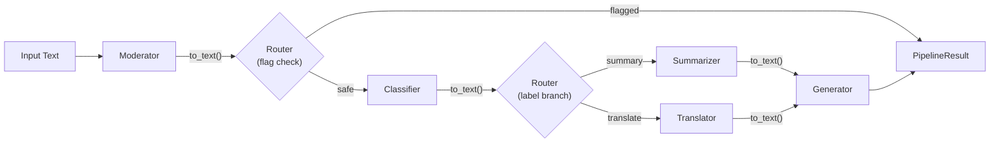

# AIForge SDK — Architecture & Technology Reference

## High-Level Architecture



---

## Technology Stack

### Core Framework

| Technology | Version | Where Used | Purpose |
|---|---|---|---|
| **Python** | 3.12+ | Entire SDK | Runtime language |
| **Pydantic v2** | ≥2.7 | `core/types.py`, `infra/config.py`, all `schemas.py` | Data validation, settings management, response models |
| **Pydantic Settings v2** | ≥2.3 | `infra/config.py` → `AIForgeSettings` | Hierarchical config: defaults → `aiforge.yaml` → `.env` → env vars → constructor kwargs |
| **structlog** | ≥24.0 | `infra/logging.py` | Structured JSON logging across all components |
| **PyYAML** | ≥6.0 | `infra/config.py` | Parsing `aiforge.yaml` configuration files |
| **tiktoken** | ≥0.7 | `core/pricing.py`, rate limiter | Token counting for cost estimation and rate limiting |

### LLM & AI Layer

| Technology | Version | Where Used | Purpose |
|---|---|---|---|
| **LangChain Core** | ≥1.0 | `core/types.py`, `providers/_langchain.py` | Message, tool-calling and structured-output abstractions shared by every provider |
| **langchain-openai** | ≥1.0 | `providers/openai.py`, `providers/azure.py` | OpenAI and Azure OpenAI provider |
| **langchain-anthropic** | ≥1.4 (extra) | `providers/anthropic.py` | Anthropic Claude provider (Opus, Sonnet, Haiku, Fable) with prompt caching |
| **langchain-ollama** | ≥1.0 (extra) | `providers/ollama.py` | Local model inference (Llama, Mistral, etc.) |
| **langchain-voyageai** | extra | `providers/anthropic.py` | Voyage AI embeddings (used with Anthropic provider) |
| **LangGraph** | ≥1.0 (extra) | `modules/qa/`, `modules/chat/` | Agentic workflows: multi-step reasoning, tool use, memory |
| **MCP SDK** | ≥2.0 (extra) | `mcp/` | Model Context Protocol client: stdio, streamable HTTP and (deprecated) SSE transports |
| **langchain-text-splitters** | ≥1.0 | `core/text_splitter.py` | Language-aware document chunking for RAG |

### Vector Store Backends

| Technology | Version | Where Used | Purpose |
|---|---|---|---|
| **ChromaDB** | ≥1.3 | `core/vectorstore.py` (default) | Embedded vector store, SQLite-backed, cosine similarity |
| **langchain-chroma** | ≥1.0 | `core/vectorstore.py` | ChromaDB ↔ LangChain integration |
| **pgvector** | extra | `core/vectorstore_factory.py` | PostgreSQL vector extension for production-scale RAG |
| **psycopg** | extra | pgvector adapter | PostgreSQL driver (binary wheels) |
| **Pinecone** | extra | `core/vectorstore_factory.py` | Managed cloud vector database |
| **Qdrant** | extra | `core/vectorstore_factory.py` | Open-source/cloud vector search engine |

### Server & API

| Technology | Version | Where Used | Purpose |
|---|---|---|---|
| **FastAPI** | extra | `server/app.py`, `server/routers/` | REST API framework with auto-generated OpenAPI docs |
| **Uvicorn** | extra | `server/app.py`, CLI `serve` command | ASGI server for FastAPI |
| **CORS Middleware** | — | `server/app.py` | Cross-origin request support for Playground/external clients |
| **Bearer Token Auth** | — | `server/middleware.py` → `AuthMiddleware` | API authentication via `secrets.compare_digest` |
| **Request Logging** | — | `server/middleware.py` → `RequestLoggingMiddleware` | UUID `X-Request-Id` per request for tracing |

### CLI & UI

| Technology | Version | Where Used | Purpose |
|---|---|---|---|
| **Typer** | ≥0.15.4 | `cli/main.py`, `cli/commands_*.py` | CLI framework (20+ commands) |
| **Rich** | ≥13.0 | `cli/` | Terminal formatting: tables, panels, progress bars |
| **Streamlit** | extra | `playground/`, `modules/*/widget.py`, `pipeline/widget.py` | Multi-page web UI (st.navigation) for interactive module testing |

### Infrastructure & Resilience

| Technology | Version | Where Used | Purpose |
|---|---|---|---|
| **Tenacity** | ≥8.0 | `infra/retry.py` → `@retry_llm_call`, `@retry_embedding_call` | Exponential backoff with jitter, 3 attempts max |
| **Redis** | optional | `infra/cache.py` → `RedisBackend` | Distributed response caching (alternative to in-memory LRU) |
| **SHA-256** | stdlib | `infra/cache.py` | Deterministic cache key generation from request params |
| **threading.Lock** | stdlib | `infra/rate_limiter.py`, `core/vectorstore.py` | Thread-safe rate limiting and vector store writes |

### Observability

| Technology | Version | Where Used | Purpose |
|---|---|---|---|
| **LangSmith** | extra | `infra/tracing.py` | LLM call tracing, evaluation, prompt debugging |
| **OpenTelemetry** | extra | `infra/tracing.py` | Distributed tracing (OTLP export), spans per LLM call |
| **structlog** | ≥24.0 | `infra/logging.py` | JSON structured logging with context binding |
| **Console Tracing** | built-in | `infra/tracing.py` | Development-mode trace output to terminal |

### Deployment

| Technology | Version | Where Used | Purpose |
|---|---|---|---|
| **Docker** | — | `Dockerfile` (multi-stage) | Containerization: builder stage (wheel + extras) → slim runtime |
| **docker-compose** | — | `docker-compose.yml` | Orchestrates `api` (port 8000) + `playground` (port 8501) services |
| **MkDocs** | extra | `mkdocs.yml` | Documentation site generation |
| **MkDocs Material** | extra | `mkdocs.yml` | Documentation theme with search, nav, code highlighting |

### Testing & Development

| Technology | Version | Where Used | Purpose |
|---|---|---|---|
| **pytest** | dev extra | `tests/` | Test framework (asyncio_mode=auto) |
| **pytest-asyncio** | dev extra | `tests/` | Async test support |
| **mypy** | dev extra | — | Static type checking (strict mode, Python 3.12) |
| **Ruff** | dev extra | — | Linting + formatting (target py312, line-length 100) |

---

## Data Flow

### 1. SDK / Module Call Flow

```
User Code
  │
  ├─→ from aiforge import Summarizer
  │       ↓
  │    Module Registry resolves Summarizer class
  │
  ├─→ s = Summarizer(provider="openai", model="gpt-4o")
  │       ↓
  │    AIForgeSettings resolved: defaults → aiforge.yaml → .env → env vars → kwargs
  │    LLM provider lazy-loaded from provider registry
  │
  └─→ result = s.run("long text here")
          ↓
      ┌─ Cache.get(SHA-256 key) ──→ HIT? Return cached response (cost=$0)
      │                               │
      │                              MISS
      │                               ↓
      ├─ RateLimiter.acquire(1 request + N tokens) ── blocks if over RPM/TPM limit
      │                               ↓
      ├─ @retry_llm_call (Tenacity: 3 attempts, exp backoff + jitter)
      │       ↓
      │   Provider.complete(messages) ──→ LLM API (HTTP) ──→ CompletionResult
      │                               ↓
      ├─ CostTracker.record(module, model, input_tokens, output_tokens, cost)
      ├─ Tracing.emit_span(trace_id, latency, model, tokens)
      ├─ Cache.set(key, response, TTL)
      └─→ ModuleResponse { result, cost, tokens, latency_ms, model }
```



### 2. REST API Flow

```
HTTP Client (curl / Playground / external)
  │
  ├─→ POST /api/v1/summarize  { "text": "...", "max_length": 200 }
  │       ↓
  │    CORS Middleware — validate origin
  │       ↓
  │    AuthMiddleware — validate Bearer token (secrets.compare_digest)
  │       ↓
  │    RequestLoggingMiddleware — generate X-Request-Id UUID, bind to structlog
  │       ↓
  │    FastAPI Route Handler (server/routers/summarize.py)
  │       ↓
  │    Instantiate Summarizer(settings from request body + server config)
  │       ↓
  │    module.run(text) → [same flow as SDK above]
  │       ↓
  └─→ JSON Response { "summary": "...", "cost": 0.001, "tokens": 150, "model": "gpt-4o" }
```

**API Endpoints:**

| Method | Path | Module |
|---|---|---|
| GET | `/health` | Health check |
| POST | `/api/v1/summarize` | Summarizer |
| POST | `/api/v1/qa` | DocQA (RAG) |
| POST | `/api/v1/extract` | Extractor |
| POST | `/api/v1/classify` | Classifier |
| POST | `/api/v1/classify/sentiment` | Classifier (sentiment mode) |
| POST | `/api/v1/search` | SemanticSearch |
| POST | `/api/v1/generate` | Generator |
| POST | `/api/v1/generate/rewrite` | Generator (rewrite mode) |
| POST | `/api/v1/chat` | ChatAgent |
| POST | `/api/v1/moderate` | Moderator |
| POST | `/api/v1/translate` | Translator |
| POST | `/api/v1/vision` | Vision |
| POST | `/api/v1/pipeline` | Pipeline Engine |
| GET | `/api/v1/jobs/{id}` | Async job status |

### 3. RAG Flow (DocQA & SemanticSearch)

```
INGEST:
  Documents / Directory
    ↓
  DocLoader — recursive file discovery (pdf, docx, txt, md, py, etc.)
    ↓
  TextSplitter — language-aware chunking (chunk_size + overlap)
    ↓
  EmbeddingProvider.embed(chunks) — OpenAI / Voyage / Ollama
    ↓
  VectorStore.upsert(embeddings, metadata, IDs)
    ↓
  Collection ready (ChromaDB SQLite, pgvector, Pinecone, or Qdrant)

QUERY:
  User question
    ↓
  EmbeddingProvider.embed_query(question) — same provider as ingest
    ↓
  VectorStore.query(vector, top_k) — cosine similarity search
    ↓
  Retrieved context chunks + similarity scores
    ↓
  LLM prompt: system context + retrieved docs + user question
    ↓
  LLM generates answer
    ↓
  LangGraph agent evaluates quality → refine if needed
    ↓
  QAResponse { answer, sources, confidence, cost, tokens }
```



### 4. Pipeline Flow

Pipelines chain modules sequentially, with optional conditional routing:

```
Input text
  ↓
Step 1: Moderator.run(text) → ModerateResponse
  ↓ to_text() extracts result text
  ↓
Router: Check if flagged → HALT pipeline (safety stop)
  ↓ (safe)
Step 2: Classifier.run(text) → ClassifyResponse { label: "summary" }
  ↓ to_text()
  ↓
Router: Branch on label
  ├─ "summary" → Step 3a: Summarizer
  └─ "translate" → Step 3b: Translator
  ↓ to_text()
Step 4: Generator.run(text) → GenerateResponse
  ↓
PipelineResult {
  steps: { step_name: ModuleResponse },
  total_cost: $0.005,
  total_tokens: 850,
  halted: false,
  halted_at: null
}
```



---

## Configuration Hierarchy

Settings are resolved in this order (later wins):

```
1. Built-in defaults (AIForgeSettings class defaults)
   ↓
2. aiforge.yaml (project-level config file)
   ↓
3. .env file (dotenv secrets)
   ↓
4. Environment variables (AIFORGE_PROVIDER, AIFORGE_MODEL, etc.)
   ↓
5. Constructor kwargs (Summarizer(provider="anthropic", model="claude-sonnet-5-5"))
```

---

## Module Architecture

Every module follows a consistent 5-file pattern:

```
aiforge/modules/<name>/
  __init__.py       ← Exports module class + response type
  module.py         ← Main class extending BaseModule (run/arun/_call_llm)
  schemas.py        ← Pydantic response model (extends ModuleResponse)
  prompts.py        ← System/user prompt templates
  widget.py         ← Streamlit UI component for Playground
```

All modules inherit from `BaseModule` which provides:

- `run(text, **kwargs)` — sync execution
- `arun(text, **kwargs)` — async execution
- `run_batch(texts, **kwargs)` — batch processing
- `_call_llm(messages)` / `_acall_llm(messages)` — provider abstraction with cache + rate limit + retry + cost tracking built in

---

## Provider Abstraction

```
LLMProvider (ABC)
  ├─ complete(messages, tools=?, response_format=?) → CompletionResult
  ├─ complete_async(messages, ...) → CompletionResult
  ├─ stream(messages) → AsyncIterator[str]
  └─ supports_tools / supports_structured_output (capability flags)

LangChainLLMProvider(LLMProvider)          ← providers/_langchain.py
  shared by all built-in providers: message conversion, native tool
  calling (bind_tools), native structured output (json_schema with a
  plain-prompt fallback), prompt-cache token accounting, streaming

EmbeddingProvider (ABC)
  ├─ embed(texts) → list[list[float]]
  ├─ embed_async(texts) → list[list[float]]
  └─ embed_query(text) → list[float]

Implementations:
  ├─ OpenAIProvider / OpenAIEmbeddingProvider
  ├─ AnthropicProvider / AnthropicEmbeddingProvider (→ Voyage AI, prompt caching)
  ├─ OllamaProvider / OllamaEmbeddingProvider
  └─ AzureProvider / AzureEmbeddingProvider
```

---

## Docker Deployment

```
┌─────────────────────────────────────────┐
│           docker-compose.yml            │
│                                         │
│  ┌─────────────┐   ┌────────────────┐  │
│  │  api         │   │  playground    │  │
│  │  :8000       │   │  :8501         │  │
│  │  FastAPI     │   │  Streamlit     │  │
│  │  + Uvicorn   │   │  (depends_on   │  │
│  │              │   │   api:healthy) │  │
│  └──────┬───────┘   └───────┬────────┘  │
│         │                   │           │
│         └───────┬───────────┘           │
│                 │                       │
│         ┌───────┴───────┐               │
│         │  Dockerfile   │               │
│         │  multi-stage  │               │
│         │  python:3.12  │               │
│         └───────┬───────┘               │
│                 │                       │
│         ┌───────┴───────┐               │
│         │  chroma-data  │               │
│         │  (volume)     │               │
│         └───────────────┘               │
└─────────────────────────────────────────┘
```
