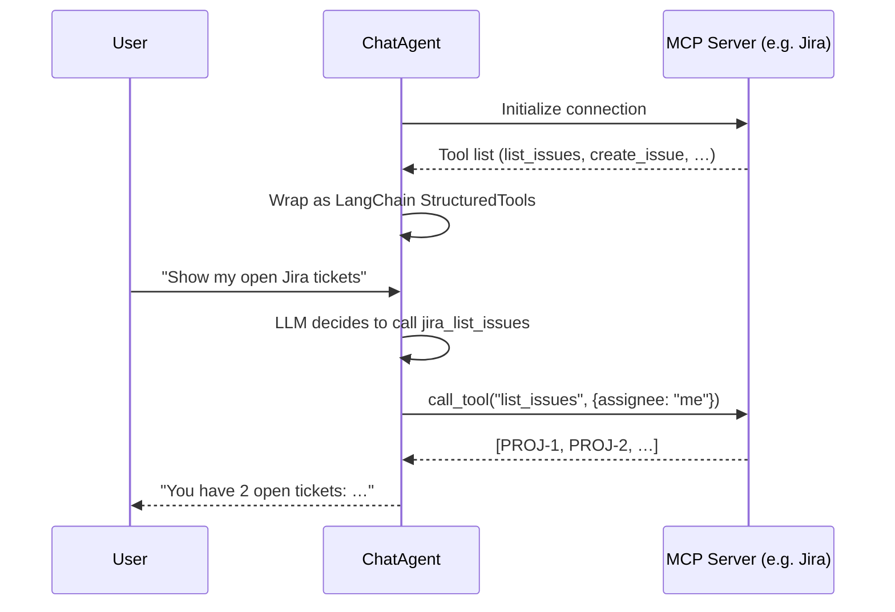

# MCP Integration

**Model Context Protocol (MCP)** lets ChatAgent connect to external tool
servers — Jira, Slack, GitHub, PostgreSQL, a custom REST API, and
[hundreds more](https://github.com/modelcontextprotocol/servers) — and use
their capabilities as part of the conversation.

## How It Works



MCP tools are **dynamically discovered** at startup — you don't need to
write tool wrappers.  They appear alongside local tools in the agent's
system prompt and are executed through the same LangGraph tool loop.

## Installation

```bash
pip install 'aiforge[mcp]'
```

## Configuration

### In `aiforge.yaml`

```yaml
mcp_servers:
  - name: jira
    transport: stdio
    command: npx
    args: ["@modelcontextprotocol/server-jira"]
    env:
      JIRA_URL: "https://your-org.atlassian.net"
      JIRA_TOKEN: "your-token"   # prefer .env for secrets

  - name: github
    transport: stdio
    command: npx
    args: ["@modelcontextprotocol/server-github"]
    env:
      GITHUB_TOKEN: "ghp_..."

  - name: custom-api
    transport: streamable_http      # or "http"
    url: "https://mcp.example.com/mcp"
    headers:
      Authorization: "Bearer ..."   # prefer .env for secrets
    timeout: 60.0
```

### In Python

```python
from aiforge import ChatAgent

agent = ChatAgent(
    mcp_servers=[
        {
            "name": "postgres",
            "transport": "stdio",
            "command": "npx",
            "args": ["@modelcontextprotocol/server-postgres"],
            "env": {"DATABASE_URL": "postgresql://..."},
        },
    ],
)
response = agent.chat("What tables are in the database?")
```

### Via REST API

```json
POST /chat
{
  "message": "Show my open tickets",
  "mcp_servers": [
    {
      "name": "jira",
      "transport": "stdio",
      "command": "npx",
      "args": ["@modelcontextprotocol/server-jira"],
      "env": {"JIRA_URL": "https://...", "JIRA_TOKEN": "..."}
    }
  ]
}
```

### Via CLI

```bash
aiforge chat --mcp-config mcp-servers.yaml
```

Where `mcp-servers.yaml` contains a list of server configs.

## Transport Modes

| Mode              | How it works                                  | When to use                          |
| ----------------- | --------------------------------------------- | ------------------------------------ |
| `stdio`           | Spawns a subprocess, pipes JSON               | Local MCP servers (npm/PyPI packages) |
| `streamable_http` | HTTP POST per message, optional SSE responses | Remote / shared / hosted servers     |
| `sse`             | Legacy HTTP+SSE transport (deprecated)        | Only servers that predate Streamable HTTP |

`http` is accepted as an alias for `streamable_http`. Configuring `sse`
emits a `DeprecationWarning`; the MCP spec replaced it with Streamable HTTP.

## Tool Namespacing

MCP tools are prefixed with the server name to avoid collisions:

- Server `jira` with tool `list_issues` → `jira_list_issues`
- Server `github` with tool `search_repos` → `github_search_repos`

This means you can connect multiple servers simultaneously without
name conflicts, and local tools are never shadowed.

## Lifecycle Management

MCP connections are managed automatically:

```python
# Option 1: Explicit close
agent = ChatAgent(mcp_servers=[...])
try:
    response = agent.chat("...")
finally:
    agent.close()

# Option 2: Async context manager
async with ChatAgent(mcp_servers=[...]) as agent:
    response = await agent.achat("...")
# Connections closed automatically
```

`reset()` clears conversation history but **keeps** MCP connections alive.

## Server Config Reference

| Field       | Type              | Default  | Description                            |
| ----------- | ----------------- | -------- | -------------------------------------- |
| `name`      | `str`             | required | Display name / tool prefix             |
| `transport` | `"stdio"\|"streamable_http"\|"sse"` | `"stdio"`| Transport protocol ( `"http"` = `"streamable_http"`) |
| `command`   | `str`             | —        | Executable for stdio (e.g. `npx`)      |
| `args`      | `list[str]`       | `[]`     | CLI arguments for stdio command         |
| `url`       | `str`             | —        | Endpoint URL for the HTTP transports    |
| `headers`   | `dict[str, str]`  | `{}`     | Extra HTTP headers (e.g. auth) for the HTTP transports |
| `env`       | `dict[str, str]`  | `{}`     | Env vars for the stdio subprocess       |
| `timeout`   | `float`           | `30.0`   | Per-tool-call timeout (seconds)         |
| `enabled`   | `bool`            | `true`   | Toggle server on/off                    |

## Finding MCP Servers

Browse the official MCP Server Registry:
<https://github.com/modelcontextprotocol/servers>

Popular servers:

| Server                  | What it does                        |
| ----------------------- | ----------------------------------- |
| `server-jira`           | Jira issue management               |
| `server-github`         | GitHub repos, issues, PRs           |
| `server-slack`          | Slack messaging                     |
| `server-postgres`       | PostgreSQL queries                  |
| `server-filesystem`     | Local file system access            |
| `server-brave-search`   | Web search via Brave                |

## Troubleshooting

**"MCP support requires the 'mcp' package"**
:   Install with `pip install 'aiforge[mcp]'`

**Server connection timeout**
:   Increase the `timeout` field or check if the MCP server command is installed
    (e.g. `npx @modelcontextprotocol/server-jira` must be runnable).

**No tools discovered**
:   The server may not expose tools. Check with `mcp list-tools` or the
    server's documentation.

**Tool call errors**
:   Check the MCP server logs. Common cause: missing environment variables
    (API keys, tokens) in the `env` config.
